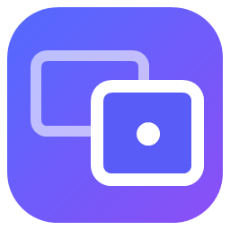
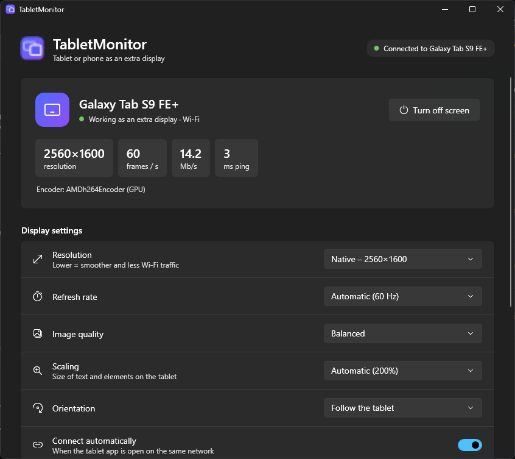
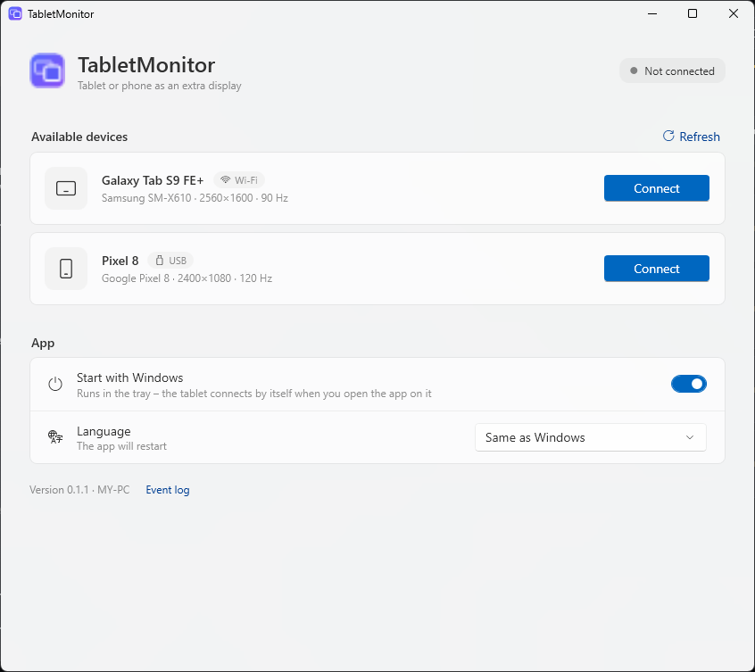

<div align="center">



# TabletMonitor

**Turn an Android tablet or phone into a real second monitor for Windows.**<br/>
Extended desktop – not a mirror – over Wi-Fi or USB, with native touch.

[](https://github.com/hpixsel/TabletMonitor/releases/latest)
[](https://github.com/hpixsel/TabletMonitor/actions/workflows/build.yml)
[](LICENSE)


**[Download](https://github.com/hpixsel/TabletMonitor/releases/latest)** · [Quick start](#quick-start) · [Features](#features) · [Building](#building)

</div>

<br/>

<table>
  <tr>
    <td></td>
    <td></td>
  </tr>
  <tr>
    <td align="center"><sub>Connected – live stats and per-tablet display settings</sub></td>
    <td align="center"><sub>Tablets found on the network and over USB</sub></td>
  </tr>
</table>

## Why

- **One file.** `TabletMonitor.exe` contains everything – the virtual display driver, adb for USB and the Android app. No Sunshine, Moonlight or extra drivers.
- **A real extra screen.** Windows sees a new monitor at the tablet's native resolution; drag windows onto it like onto any other display.
- **Fast.** The screen is encoded on your GPU and decoded in hardware on the tablet. Nothing is sent while the screen is still.
- **No leftovers.** The extra screen exists only while a tablet is connected. Afterwards it disappears from Windows completely.

## Quick start

1. Download `TabletMonitor-<version>-win-x64.exe` from the [latest release](https://github.com/hpixsel/TabletMonitor/releases/latest), run it and click **Install and start** (one administrator prompt).
2. Install `TabletMonitor-<version>.apk` on the tablet – or plug the tablet in via USB with USB debugging on and the PC installs the app for you.
3. Open the app on the tablet and tap your PC, or click **Connect** on the PC. Next time it connects by itself.

> [!NOTE]
> The exe is not code-signed yet, so Windows SmartScreen may say *“Windows protected your PC”*. Choose **More info → Run anyway**. SHA-256 checksums are attached to every release.

## Features

| | |
|---|---|
| 🖥️ **Display** | Native or half resolution, 30–144 Hz, automatic scaling from the tablet's pixel density, portrait mode that follows the tablet |
| 👆 **Input** | Native Windows touch – tap, scroll, pinch zoom, press-and-hold for right click; the PC mouse cursor is drawn on the tablet |
| 📶 **Connection** | Automatic discovery on the local network, auto-connect for trusted tablets, approval of new ones on the PC; USB via built-in adb |
| ⚡ **Streaming** | Hardware H.264 on AMD / NVIDIA / Intel GPUs (Media Foundation), low-latency hardware decoding on Android |
| 🔄 **Updates** | Both apps check GitHub Releases and update in place; every download is verified against the release's SHA-256 checksums |
| 🌗 **Apps** | Windows 11 Fluent design and Material 3 on Android, light and dark theme, English and Polish |

## Known limitations

- The stylus works like a finger for now (no pressure, hover or barrel button).
- One tablet at a time.
- The PC side is Windows only (x64, Windows 10 2004 or newer).

## How it works

```
Windows                                                        Android
───────                                                        ───────
Virtual Display Driver ─► DXGI Desktop Duplication            MediaCodec (H.264) ─► SurfaceView
   (extra monitor)          ─► GPU colour conversion   ──TCP──►   + cursor overlay
                            ─► GPU H.264 encoder                    │
InjectTouchInput  ◄─────────────────── touch events ◄──────────────┘
```

The protocol is described in [docs/PROTOCOL.md](docs/PROTOCOL.md). Admin-only steps (switching the virtual adapter on and off, adding a new tablet resolution) are done by a small `TabletMonitorService` installed once, so the app never asks for administrator rights in daily use.

## Building

Requirements: .NET 10 SDK, JDK 17+ and the Android SDK (`ANDROID_HOME` or `android/local.properties`).

```powershell
./build.ps1               # → build/TabletMonitor.exe (APK embedded) and build/TabletMonitor.apk
./build.ps1 -SkipAndroid  # Windows app only, reuses build/TabletMonitor.apk
```

Releasing a new version (bumps versions, builds, publishes the release that the apps update from):

```powershell
./release.ps1 -Version 0.3.0 -NotesFile notes.md
```

| Folder | Contents |
|---|---|
| [`windows/`](windows) | Windows app – .NET 10, WPF (Fluent), single self-contained exe |
| [`android/`](android) | Android app – Kotlin, Jetpack Compose, Material 3 |
| [`docs/`](docs) | Protocol description, README images |
| [`third_party/`](third_party) | Signed [Virtual Display Driver](https://github.com/VirtualDrivers/Virtual-Display-Driver) (MIT) |

<details>
<summary>More build and diagnostics notes</summary>

- The first build downloads adb (Android SDK Platform-Tools) from Google into `third_party/adb`; it is not stored in the repository.
- The release APK is signed with the key in `android/signing/` (not in git – `signing.properties` with `storeFile`, `storePassword`, `keyAlias`, `keyPassword`). Without it the debug key is used.
- Log file: `%LOCALAPPDATA%\TabletMonitor\log.txt` (the *Event log* link in the app).
- `TabletMonitor.exe --selftest out.h264 [W H Hz seconds]` – turns on the virtual display and records the encoded stream (driver + capture + encoder without a tablet).
- `TabletMonitor.exe --touchtest out.txt` – injects a tap, a drag and a stylus tap into a test window on the virtual display.
- `TabletMonitor.exe --screenshot out.png connected|devices|empty dark|light en|pl [height]` – renders the main window with sample devices (README images).
- `TabletMonitor.exe --uninstall` – removes the app, the service and the driver (also in *Settings → Apps*).

</details>

## License

[MIT](LICENSE) © Kacper Adamus. Bundled third-party components are listed in [THIRD_PARTY_NOTICES.md](THIRD_PARTY_NOTICES.md).
